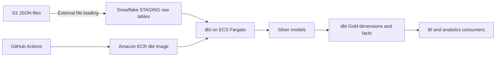
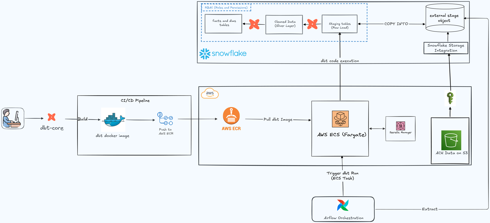

# ACHS Analytics Platform

ACHS Analytics Platform is a Snowflake data warehouse and dbt transformation project for healthcare data. It loads JSON records into a raw staging layer, standardizes them into Silver models, and publishes Gold dimensions and fact tables for analytics.

The repository also contains Terraform configuration for the AWS and Snowflake resources used by the deployment, plus GitHub Actions workflows for validating infrastructure and publishing the dbt container image.

## Contents

- [ACHS Analytics Platform](#achs-analytics-platform)
  - [Contents](#contents)
  - [Architecture](#architecture)
  - [Data models](#data-models)
    - [Silver](#silver)
    - [Gold](#gold)
  - [Repository layout](#repository-layout)
  - [Requirements](#requirements)
  - [Run dbt locally](#run-dbt-locally)
  - [Container and deployment](#container-and-deployment)
  - [Infrastructure](#infrastructure)
  - [Security and data handling](#security-and-data-handling)
  - [Current scope and limitations](#current-scope-and-limitations)

## Architecture





The Terraform configuration provisions an S3 external stage and JSON file format in Snowflake. It also creates raw landing tables with a `RAW_JSON` `VARIANT` column and load metadata. The five dbt source tables are `PATIENTS_RAW`, `PROVIDERS_RAW`, `ENCOUNTERS_RAW`, `DIAGNOSES_RAW`, and `CLAIMS_RAW`.

The dbt source definitions use the active profile's database and schema. The checked-in profile targets the `STAGING` schema, which is where the raw tables are provisioned.

## Data models

The project has two transformation layers:

### Silver

The Silver models extract typed fields from each raw JSON record:

| Model | Source | Main contents |
| --- | --- | --- |
| `silver_patients` | `PATIENTS_RAW` | Patient identity, birth date, contact details, gender, hashed social security identifier, and primary insurance. Keeps the latest loaded row for each patient. |
| `silver_providers` | `PROVIDERS_RAW` | Provider identifier, NPI, provider type, specialty, facility, active status, and hire date. Keeps the latest loaded row for each provider. |
| `silver_encounters` | `ENCOUNTERS_RAW` | Encounter, patient, and provider identifiers, start and end timestamps, admission source, and encounter class. |
| `silver_diagnoses` | `DIAGNOSES_RAW` | Diagnosis and encounter identifiers, ICD-10 code, diagnosis rank, coding system, and recorded timestamp. |
| `silver_claims` | `CLAIMS_RAW` | Claim and encounter identifiers, payer, billed and paid amounts, patient responsibility, claim status, denial reason, reimbursement rate, and processing date. |

Phone numbers and extensions are normalized for patients, and provider active status is converted to a boolean. The project-level configuration sets Silver models to views, but each current Silver SQL model explicitly sets `materialized='table'`, so these models are built as tables.

### Gold

Gold models are configured as tables and are intended for downstream reporting:

| Model | Description |
| --- | --- |
| `dim_date` | A date dimension with a `YYYYMMDD` numeric key, calendar date, month name, and year. It generates 10,000 consecutive dates starting on 2020-01-01. |
| `dim_patients` | Patient analytical attributes, including patient identifier, name, hashed social security identifier, birth date, gender, ZIP code, and primary insurance. |
| `dim_providers` | Provider attributes including NPI, provider type, specialty, facility, active status, and hire date. |
| `fct_encounters` | Encounter details with patient and provider identifiers, start and end date keys, and visit duration in minutes. |
| `fct_diagnoses` | Diagnosis details joined to encounter patient identifiers, with a date key derived from the recorded timestamp. |
| `fct_claims` | Claim amounts and adjudication fields, joined to patient and provider identifiers through encounters. |

The fact models use left joins when bringing in related encounter information. Records without a matching encounter can therefore remain in the corresponding fact model with missing joined attributes.

## Repository layout

```text
.
├── .github/workflows/
│   ├── dbt-ecr-cicd.yml
│   └── terraform-ci.yml
├── dbt_project/
│   └── achs_dbt_project/
│       ├── macros/
│       ├── models/
│       │   ├── gold/
│       │   └── silver_layer/
│       ├── dbt_project.yml
│       ├── packages.yml
│       ├── profiles.yml
│       └── Dockerfile
└── infra/
    └── eu-central-1/production/
```

The dbt project also defines utility macros for phone formatting, extension extraction, boolean conversion, cents-to-dollars conversion, and schema naming. The cents-to-dollars macro is available for model use but is not currently called by the included models.

## Requirements

- A Snowflake account with access to the project database, schemas, warehouse, source tables, and required roles.
- A dbt CLI installation that supports the project's Snowflake adapter and strict static analysis configuration.
- Python and pip if installing dbt locally.
- Docker if building the dbt image.
- Terraform and appropriately authorized AWS and Snowflake credentials if managing infrastructure.

The repository does not include a separate Python dependency lock file. Install a dbt CLI and Snowflake adapter version appropriate for your environment. The Dockerfile uses Python 3.11.

## Run dbt locally

1. Configure the `achs_dbt_project` profile in `dbt_project/achs_dbt_project/profiles.yml` for your Snowflake account. The profile includes connection settings and reads the private key from the `SNOWFLAKE_PRIVATE_KEY` environment variable. Supply credentials through your approved local secret manager or environment configuration. Do not commit credentials.
2. From the repository root, enter the dbt project and point dbt to its profile file:

   ```sh
   cd dbt_project/achs_dbt_project
   export DBT_PROFILES_DIR="$PWD"
   ```

3. Install declared dbt packages and validate connectivity:

   ```sh
   dbt deps
   dbt debug
   ```

4. Build the project:

   ```sh
   dbt build
   ```

`dbt build` builds selected models and runs any configured tests. The current repository does not define project-specific model or source tests. Use `dbt run` to execute model builds without the build command's test and seed selection.

## Container and deployment

The Dockerfile is in `dbt_project/achs_dbt_project`. It installs dbt, copies the project into the image, sets the profile directory to the project directory, and runs `dbt run` by default.

Build and run the image locally from the dbt project directory:

```sh
cd dbt_project/achs_dbt_project
docker build -t achs-dbt:local .
docker run --rm achs-dbt:local
```

The container needs valid Snowflake connection settings and the private key environment variable at runtime. Use a secure runtime secret mechanism rather than adding credentials to the image or repository.

GitHub Actions currently:

- Builds and pushes the dbt container image to Amazon ECR on pushes to `deployment-branch` and when a pull request targeting `main` is closed.
- Runs Terraform formatting and validation checks on pushes to `main`.

The image workflow publishes the `latest` tag. The Terraform workflow runs formatting and validation; it does not apply infrastructure changes. The workflows do not include a step that starts an ECS task after publishing an image.

## Infrastructure

Terraform configuration is under `infra/eu-central-1/production`. It manages resources including:

- A Snowflake database, `STAGING`, `SILVER`, and `GOLD` schemas, a dbt warehouse, and the five raw landing tables.
- A Snowflake external stage and storage integration for S3 JSON files.
- Snowflake service users and roles for dbt and Airflow, with grants to the warehouse, schemas, tables, and stage.
- AWS IAM roles and policies for GitHub Actions, ECS task execution, and Snowflake access to S3.
- An Amazon ECR repository, ECS cluster and Fargate task definition, CloudWatch log group, and SSM parameters for runtime credentials.

Terraform uses an S3 backend, so the state bucket and required permissions must be available before initializing the configuration. Review all Terraform plans and environment-specific values before applying changes. The included configuration describes production resources and should not be applied to an account without authorization and review.

To check the Terraform configuration, run these commands from its directory with Terraform installed and the required backend access configured:

```sh
cd infra/eu-central-1/production
terraform init
terraform fmt -check
terraform validate
terraform plan
```

`terraform plan` can contact the configured providers and remote state backend. Do not run `terraform apply` until the plan and target account have been reviewed and approved.

## Security and data handling

This project processes healthcare-related data. Raw patient data may contain direct identifiers and sensitive attributes. Use only approved data, restrict access to the warehouse and S3 location, and follow your organization's privacy and retention requirements.

Never commit private keys, passwords, `.env` files, Terraform state, or other credentials. Use the existing secret-management integrations or an equivalent approved secure mechanism. Review changes carefully before publishing this repository or its container image.

## Current scope and limitations

- The dbt project defines transformations from existing Snowflake raw tables. It does not include a standalone ingestion application or an Airflow deployment.
- Terraform creates Snowflake's S3 stage and raw tables, but the repository does not include a complete file-loading orchestration workflow.
- Silver SQL models currently materialize as tables, despite the project-level Silver default being views.
- Gold models include `date_key` fields, but the SQL does not declare formal primary-key, foreign-key, or relationship tests.
- No project-specific dbt tests or model documentation YAML files are currently defined.
- The production Terraform and GitHub Actions configuration depend on AWS, Snowflake, and GitHub identity settings that must be supplied and authorized for the deployment environment.
